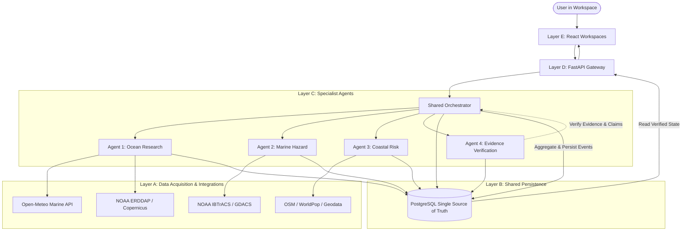

# ORCA System Architecture Specification

## 1. High-Level Overview

ORCA operates as an integrated multi-agent scientific intelligence system built on five connected architectural layers:

## 2. Layer Responsibilities

### Layer A — Data Acquisition & External Providers
- Interacts with live and historical data APIs via asynchronous HTTP (`HTTPX`).
- Normalizes external provider payloads into typed domain structures.
- Retains original source metadata: observation time, retrieval timestamp, coordinate bounding boxes, units, and licenses.
- Handles rate-limiting, provider downtime, and invalid schemas cleanly without throwing uncaught exceptions.

### Layer B — Shared Data & Evidence Layer (PostgreSQL)
- Single source of truth across all teammates and workspaces.
- Stores queryable marine observations, hazard tracks, coastal infrastructure, investigations, execution events, and evidence records.
- Enforces strict referential integrity between findings and evidence records.
- Employs UTC timestamps and WGS84 (EPSG:4326) coordinates.

### Layer C — Four Specialist Agents
- **Ocean Intelligence & Research:** Marine environmental variables, SST time series, seasonal analysis, anomaly computation.
- **Marine Hazard & Forecast:** Cyclone tracks, storm positions, marine weather hazards, forecast issue/validity windows.
- **Coastal Impact & Risk:** Spatial intersections, settlement exposure calculations, asset vulnerability analysis.
- **Evidence & Scientific Verification:** Validates findings against evidence records, detects contradictions and stale data, assigns verification states.

### Layer D — Orchestrator & Execution Pipeline
- Entry point for all multi-agent investigations.
- Constructs an execution plan matching the user's intent.
- Executes agents sequentially or concurrently as needed.
- Emits genuine execution events (`investigation_started`, `agent_started`, `tool_completed`, `evidence_added`, `agent_completed`, `verification_passed`, `investigation_completed`).
- Compiles the final verified report and stores results in PostgreSQL.

### Layer E — React Multi-Workspace Application
- One unified Vite + React + TypeScript web application serving five tailored workspaces: Fisherman, Marine Monitoring, Protected Areas, Coastal Authority, and Disaster Management.
- Real-time or polled investigation tracking based on genuine execution events.
- MapLibre GL JS for spatial overlays (cyclone tracks, exposure zones, stations).
- Recharts for time series and anomaly visualization.
- Interactive evidence inspection drawer allowing users to inspect every cited record.
