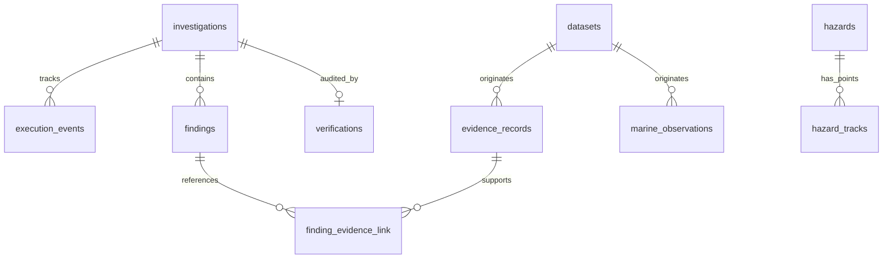

# ORCA Database Schema Specification

PostgreSQL is the single source of truth for ORCA. All models inherit from SQLAlchemy 2.x `DeclarativeBase` and use Alembic for versioned schema migrations.

## 1. Tables Overview

| Table Name | Description | Key Columns |
|---|---|---|
| `datasets` | Metadata regarding ingested providers, licenses, and bounds | `id`, `name`, `source_url`, `license`, `temporal_coverage` |
| `marine_observations` | Granular physical & biological ocean observations | `id`, `dataset_id`, `variable`, `value`, `unit`, `lat`, `lon`, `obs_time` |
| `hazards` | Tropical cyclones, storm events, hazard alerts | `id`, `name`, `type`, `basin`, `status`, `start_time`, `end_time` |
| `hazard_tracks` | Track points for cyclone and storm paths | `id`, `hazard_id`, `time`, `lat`, `lon`, `wind_knots`, `pressure_hpa` |
| `marine_forecasts` | Hourly wave height, period, direction, swell forecasts (Open-Meteo) | `id`, `provider`, `model`, `latitude`, `longitude`, `valid_time`, `wave_height_m`, `wave_period_s`, `wave_direction_deg`, `wind_wave_height_m`, `swell_wave_height_m`, `retrieval_time` |
| `cyclone_forecast_runs` | Active tropical cyclone advisory forecast runs (NOAA NHC) | `id`, `storm_id`, `storm_name`, `basin`, `provider`, `advisory_number`, `issue_time`, `retrieval_time`, `source_url` |
| `cyclone_forecast_positions` | Future predicted cyclone waypoint positions (TAU 0h..120h) | `id`, `forecast_run_id`, `lead_time_hours`, `valid_time`, `latitude`, `longitude`, `max_wind_knots`, `wind_gusts_knots`, `min_pressure_hpa`, `classification`, `stage_description` |
| `geographic_features` | Coastal settlements, infrastructure, ports, protected areas | `id`, `name`, `feature_type`, `lat`, `lon`, `properties` |
| `investigations` | User inquiries, workspace context, query, and status | `id`, `workspace`, `query`, `status`, `created_at`, `completed_at` |
| `execution_events` | Real-time agent and orchestrator execution trace | `id`, `investigation_id`, `agent_id`, `event_type`, `payload`, `timestamp` |
| `evidence_records` | Verifiable facts retrieved from external sources | `id`, `dataset_id`, `source_url`, `obs_time`, `retrieval_time`, `geom` |
| `findings` | Scientific findings produced by specialist agents | `id`, `investigation_id`, `agent_id`, `claim`, `value`, `unit`, `uncertainty` |
| `finding_evidence_link` | Many-to-many relationship linking findings to evidence | `finding_id`, `evidence_id` |
| `verifications` | Audit decisions created by Agent 4 | `id`, `investigation_id`, `state`, `summary`, `created_at` |

---

## 2. DDL & Entity Relationship (ER) Conceptual Design

## 3. Data Integrity & Indexing Rules

- **Time Standard:** All timestamps stored as `TIMESTAMP WITH TIME ZONE` in UTC.
- **Coordinates:** `latitude` (`NUMERIC(9,6)`) and `longitude` (`NUMERIC(9,6)`) in EPSG:4326 (WGS84).
- **Indexes:**
  - `ix_marine_obs_time_lat_lon`: Composite index on `(observation_time, latitude, longitude)`.
  - `ix_hazard_tracks_hazard_time`: Index on `(hazard_id, time)`.
  - `ix_execution_events_investigation`: Index on `(investigation_id, timestamp)`.
  - `ix_findings_investigation`: Index on `(investigation_id)`.
  - `ix_evidence_records_lookup`: Index on `(dataset_id, observation_time)`.
